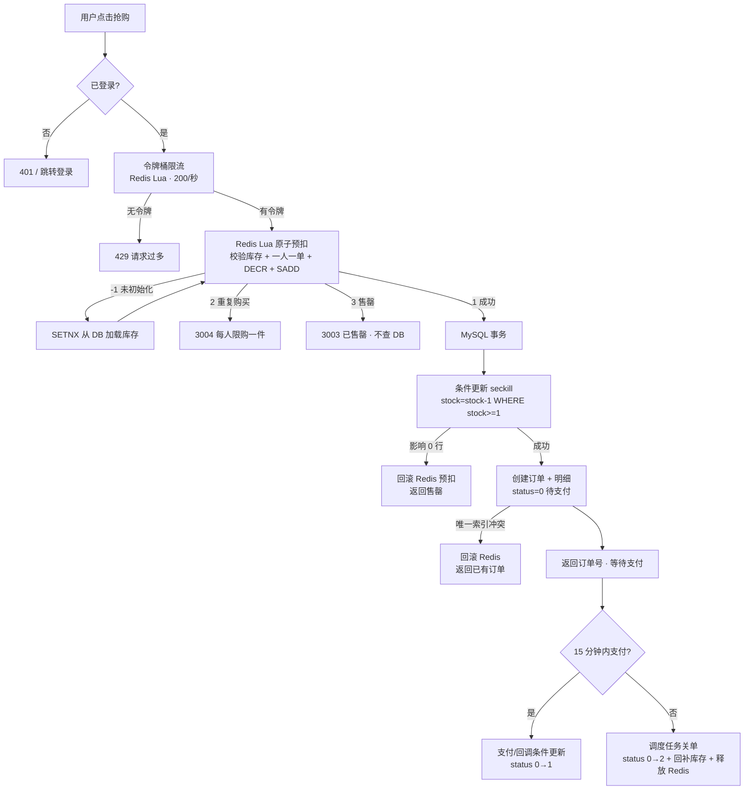

# Seckill Mall · Laravel 10 + Vue 3 电商秒杀 Demo

一套用于面试展示的前后端分离电商 Demo。重点不在页面数量，而在**缓存一致性、秒杀防超卖、订单幂等与超时关单**这些后端考点，核心代码旁均有 `【面试备注】`。

> 项目定位：异步落库、完整支付、复杂权限等生产化能力用注释说明，不在此 Demo 中实现。

---

## 1. 功能清单

| 模块 | 已实现 |
| --- | --- |
| 商品 | 列表、详情、秒杀标签、详情缓存、更新后主动删缓存 |
| 购物车 | 加入（同商品累加）、改数量、勾选、删除、结算预览 |
| 订单 | 创建、列表、详情、待支付/已支付/已关闭状态流转 |
| 秒杀 | 倒计时、令牌桶限流、Redis Lua 原子预扣、一人一单、MySQL 条件更新兜底、秒杀独立页 |
| 支付 | 模拟支付按钮、支付回调接口（均幂等） |
| 关单 | Laravel 调度命令扫描超时未支付订单，事务内关单 + 回滚库存 + 释放 Redis 预扣 |
| 基础 | 手机号 + 密码登录（Sanctum Token）、统一 `{code, message, data}`、Swagger 文档 |

---

## 2. 目录结构

```
laravel-ecommerce-demo/
├── backend/                     # Laravel 10
│   ├── app/
│   │   ├── Console/Commands/    # 超时关单、压测用户生成
│   │   ├── Exceptions/          # 业务异常 + 统一 JSON 异常处理
│   │   ├── Http/Controllers/Api # 只做参数校验与响应
│   │   ├── Models/              # Eloquent 模型
│   │   ├── OpenApi/             # Swagger 全局信息
│   │   ├── Repositories/        # 数据访问层（SQL/Eloquent）
│   │   ├── Services/            # 业务层（缓存、事务、幂等、秒杀）
│   │   └── Support/             # 统一响应、错误码、Redis Key
│   ├── database/migrations/     # 6 张业务表 + Sanctum 表
│   ├── database/seeders/        # 10 个商品、1 个秒杀活动、2 个测试用户
│   ├── resources/lua/           # seckill / 限流 / 回滚 / 解锁脚本
│   └── routes/api.php
├── frontend/                    # Vue 3 + Vite + Element Plus
│   └── src/
│       ├── api/                 # 接口封装
│       ├── components/          # 倒计时
│       ├── router/              # 路由 + 登录守卫
│       ├── stores/              # Pinia 登录态持久化
│       ├── utils/request.js     # axios 统一拦截 code/message
│       └── views/               # 首页/详情/购物车/结算/订单/秒杀/登录
├── tools/
│   ├── seckill_stress.php       # PHP curl_multi 并发压测 + 一致性校验
│   └── README.md                # ab / JMeter / MeterSphere 说明
├── work/                        # 本地验证中间产物（PHP 8.2、MySQL 数据目录、日志）
└── README.md
```

分层约定：**Controller（参数/响应）→ Service（业务/事务/缓存）→ Repository（SQL）**，Controller 不写 SQL，Repository 不写业务判断。

---

## 3. 技术栈与本地验证版本

| 组件 | 版本 |
| --- | --- |
| Laravel | 10.49.1 |
| PHP | 8.2.35（系统默认只有 8.0.2，不满足 Laravel 10 要求，验证时使用 `work/php82`） |
| MySQL | 8.0.42（验证时用 3307 端口的独立实例，未改动系统已有 3306 服务） |
| Redis | 5.0.14.1 |
| Node / npm | v22.14.0 / 11.6.4 |
| 前端 | Vue 3.5 + Vite 8 + Element Plus 2.14 + Pinia + Vue Router 4 + Axios |

> 本项目使用 **predis（纯 PHP 客户端）**，不需要安装 phpredis 扩展；MariaDB 也兼容（生成列/条件更新需 MySQL 5.7+ / MariaDB 10.2+，推荐 MySQL 8）。

---

## 4. 启动步骤

### 4.1 前置条件

- PHP >= 8.1，扩展：`pdo_mysql`、`mbstring`、`openssl`、`curl`、`fileinfo`、`bcmath`、`tokenizer`、`xml`
- MySQL 8.0，已创建数据库 `laravel_ecommerce`（`utf8mb4`）
- Redis 已启动（默认 `127.0.0.1:6379`，无密码）
- Node.js >= 20

### 4.2 后端

```bash
cd backend

composer install
cp .env.example .env          # Windows: copy .env.example .env
php artisan key:generate

# 按本机修改 .env：DB_PORT / DB_DATABASE / REDIS_HOST 等
# 本项目默认 REDIS_CLIENT=predis、REDIS_PREFIX= 为空

php artisan migrate --seed
php artisan serve --host=127.0.0.1 --port=8000
```

测试账号：`13800138000 / 123456`（Seeder 生成；另有 `13800138001`）。

本地验证时（系统 PHP 8.0 无法运行 Laravel 10）：

```powershell
& "work\php82\php.exe" artisan migrate:fresh --seed
& "work\php82\php.exe" artisan serve --host=127.0.0.1 --port=8000
```

> `work/php82` 只是本次验证下载的运行时，不属于业务代码；`.env` 中 DB_PORT=3307 也是本地独立实例端口，常规环境改成 3306 即可。

### 4.3 定时关单任务

开发环境：

```bash
php artisan schedule:work
```

Linux 生产环境 cron：

```
* * * * * cd /path/to/backend && php artisan schedule:run >> /dev/null 2>&1
```

调度内容见 `app/Console/Kernel.php`：每分钟执行 `orders:close-expired --minutes=15`。

### 4.4 前端

```bash
cd frontend
npm install
npm run dev
```

访问 <http://localhost:5173>。Vite 已配置 `/api` 代理到 `http://127.0.0.1:8000`。

### 4.5 Swagger

关键接口使用 OpenAPI Attributes 注解（`app/Http/Controllers/Api/*`）：

- Swagger UI：<http://127.0.0.1:8000/api/documentation>
- JSON（供 Apifox / JMeter 导入）：<http://127.0.0.1:8000/docs>

重新生成：

```bash
php artisan l5-swagger:generate
```

---

## 5. 核心设计

### 5.1 Redis 缓存体系（`app/Services/CacheService.php`）

| 问题 | 处理 | 关键实现 |
| --- | --- | --- |
| 缓存穿透 | 空值缓存，TTL 60 秒 | 查库为 `null` 时写入 `{"__null__":true}`，避免恶意 id 反复打库 |
| 缓存击穿 | SETNX 互斥重建，锁 TTL 3 秒 | 抢到锁的线程二次检查后回源；未抢到的线程轮询 5×100ms 读缓存；释放锁用 Lua 校验 token，避免误删 |
| 缓存雪崩 | TTL 随机偏移 0~20% | 详情基础 TTL 600 秒，列表 120 秒 |
| 更新一致性 | 先更新 DB，再删除缓存 | `GoodsService::update()`；注释解释了“先删缓存”为什么会让旧值被并发读回填 |

缓存 key：`demo:goods:detail:{id}`、`demo:goods:list`、锁 `demo:lock:cache:{key}`。

### 5.2 秒杀链路（`app/Services/SeckillService.php` + `resources/lua/seckill.lua`）

固定链路：

```
请求 → 令牌桶限流 → Redis Lua 原子预扣 → 抢到才创建订单 → 等待支付
```

- **令牌桶**：`resources/lua/rate_limit.lua`，单活动全局容量 200、速率 200 个/秒；时间取 Redis `TIME`，避免多机时钟漂移；失败返回 `3005` + HTTP 429。
- **Lua 原子预扣**：库存校验、`DECR`、`SADD 一人一单` 在一个脚本内完成，返回：
  - `1` 成功；`2` 重复购买；`3` 售罄；`-1` 库存未初始化（PHP 侧 `SETNX` 从 DB 初始化后重试一次）
- **抢失败不打 DB**：售罄/重复直接返回。
- **MySQL 兜底**：`UPDATE seckill SET stock=stock-1 WHERE id=? AND status=1 AND stock>=1`，影响行数为 0 时抛异常。
- **失败补偿**：本地事务失败调用 `seckill_rollback.lua`，`INCR` 库存 + `SREM` 用户标记。
- **一人一单双保险**：
  - Redis Set `demo:seckill:users:{id}`；
  - MySQL 生成列 `active_seckill_user_id = IF(status IN (0,1), user_id, NULL)` + 唯一索引 `(seckill_id, active_seckill_user_id)`。
  - 这样**待支付/已支付**订单占用名额，**已关闭**订单自动释放名额，用户超时关单后可以重新抢。

### 5.3 订单安全（`app/Services/OrderService.php`）

- **下单幂等**：前端携带 `X-Request-Id`；Redis `SET NX EX 600` 去重 + DB `uk_orders_request_id` 唯一索引兜底。重复请求返回同一订单（幂等判断放在购物车校验之前，避免首次下单删空购物车后重试失败）。
- **库存扣减**：逐商品条件更新，任一失败整单回滚；按 `goods_id` 排序扣减降低死锁概率。
- **状态机**：`0 待支付 → 1 已支付` / `0 → 2 已关闭`，全部用条件更新 / 行锁保证单向流转。
- **支付幂等**：已支付再次支付或重复回调直接返回成功；库存在下单时已扣，支付不重复加减。
- **超时关单**：扫描 `status=0 AND created_at<=now-15min`，行锁后条件更新为 2，同一事务回补商品库存；秒杀订单额外回补秒杀库存、Redis 预扣和一人一单标记。

### 5.4 MySQL 索引与排查

| 表 | 索引 | 用途 |
| --- | --- | --- |
| `users` | `uk_users_phone` | 手机号登录 |
| `orders` | `uk_orders_order_no`、`uk_orders_request_id`、`uk_orders_seckill_active_user` | 订单号、幂等键、一人一单 |
| `orders` | `idx_orders_user_status`、`idx_orders_status_created` | 我的订单、超时扫描 |
| `order_items` | `idx_order_items_order`、`idx_order_items_goods` | 订单详情、商品销量统计 |
| `seckill` | `idx_seckill_goods_status`、`idx_seckill_time` | 活动查询 |
| `goods` | `idx_goods_status` | 上架商品列表 |

慢查询排查思路（注释中也有）：

1. 开启 `slow_query_log`，`long_query_time=1`，用 `pt-query-digest` 聚合；
2. `EXPLAIN` 关注 `type`（`ALL` 全表 / `index` 全索引扫描要警惕）、`rows`、`filtered`；
3. `Extra` 出现 `Using filesort` / `Using temporary` 时，考虑把排序字段加入联合索引；
4. 超时扫描使用 `(status, created_at)`，避免对全表 `status=0` 做过滤。

悲观锁与乐观锁对比注释见 `app/Repositories/GoodsRepository.php`、`app/Repositories/OrderRepository.php`。

---

## 6. 秒杀业务流程图



---

## 7. 压测与超卖验证

完整参数与 ab/JMeter/MeterSphere 用法见 [`tools/README.md`](tools/README.md)。

### 7.1 并发验证（PHP 脚本）

```bash
# 后端目录
php artisan migrate:fresh --seed
php artisan demo:make-users 150

# 项目根目录
php tools/seckill_stress.php --users=150 --concurrency=50 \
  --base=http://127.0.0.1:8000,http://127.0.0.1:8001,http://127.0.0.1:8002
```

脚本会自动校验：

- `剩余库存 >= 0`
- `成功数 == 库存减少量`
- `新增订单数 == 成功数`
- 成功订单号无重复

本次实测（150 用户抢 100 件）：

```
登录成功: 150/150
结果: 成功 100 | 售罄 50 | 重复 0 | 限流 0 | 其他 0
唯一订单号: 100
DB 剩余库存: 0 | 库存减少: 100 | 本轮新增订单: 100
一致性校验: ✅ 通过（无超卖、无重复订单）
```

### 7.2 手工验证超卖

```sql
-- 活动库存不能为负
SELECT stock FROM seckill WHERE id = 1;

-- 成功订单数必须等于已售数量
SELECT COUNT(*) FROM orders WHERE seckill_id = 1;
```

```bash
redis-cli GET demo:seckill:stock:1
redis-cli SCARD demo:seckill:users:1   # 不应超过成功人数
```

### 7.3 验证缓存三件套

```bash
# 详情缓存 TTL（约 600~720 秒随机）
curl http://127.0.0.1:8000/api/goods/1
redis-cli TTL demo:goods:detail:1

# 穿透：不存在的 id → 空值缓存 60 秒
curl http://127.0.0.1:8000/api/goods/999999
redis-cli TTL demo:goods:detail:999999

# 主动删缓存：更新商品后 key 应立即消失
curl -X PUT http://127.0.0.1:8000/api/goods/1 \
  -H "Authorization: Bearer <token>" -H "Content-Type: application/json" \
  -d '{"price": 288}'
redis-cli EXISTS demo:goods:detail:1
```

### 7.4 验证订单幂等 / 支付幂等 / 超时关单

```bash
# 同一个 X-Request-Id 连发两次，订单号相同，DB 只有一条
curl -X POST http://127.0.0.1:8000/api/orders \
  -H "Authorization: Bearer <token>" \
  -H "X-Request-Id: fixed-token-001" \
  -H "Content-Type: application/json" -d '{"cart_ids":[1]}'

# 支付两次 / 回调两次，均返回成功且状态只变一次
curl -X POST http://127.0.0.1:8000/api/orders/<orderNo>/pay -H "Authorization: Bearer <token>"
curl -X POST http://127.0.0.1:8000/api/payments/callback \
  -H "Content-Type: application/json" -d '{"order_no":"<orderNo>"}'

# 立即关闭所有待支付订单，观察 goods/seckill 库存回补、Redis 库存回升
php artisan orders:close-expired --minutes=0
```

---

## 8. 已验证 / 未验证（如实说明）

**已验证（Windows 本机实跑）**

- `composer install`（Laravel 10.49.1 + l5-swagger + predis）、`php artisan migrate:fresh --seed` 成功；
- 登录、商品列表/详情、加入购物车、结算预览、下单、订单列表、模拟支付、支付回调全部实际请求通过；
- 详情缓存 TTL 实测 607 秒，空值缓存 TTL 60 秒；更新商品后缓存 key 立即删除；
- 同一 `X-Request-Id` 重复下单返回同一订单号，DB 仅一条订单；
- 重复支付/重复回调均返回成功，状态仍为已支付；
- 超时关单后商品库存回补（50 → 49 → 50），订单变为已关闭；
- 秒杀抢购成功后 Redis 库存 100 → 99，重复抢购返回 3004；关单后 Redis/DB 库存恢复 100 且用户可重新抢；
- 150 用户并发压测：成功 100、售罄 50、DB 库存 0、订单 100，无超卖/重复；
- Swagger UI `/api/documentation` 返回 200；
- 前端 `npm run build` 通过，并用浏览器实测：首页 10 个商品、登录、购物车 → 结算 → 下单 → 模拟支付、秒杀 100 → 99 全部通过。

**未验证 / 未包含**

- Linux + Nginx + PHP-FPM 部署、HTTPS、跨域生产配置；
- phpredis 扩展（本项目用 predis）；
- RabbitMQ/Kafka 异步落库（Demo 同步实现，注释说明生产方案）；
- 真实第三方支付、退款、对账；
- JMeter / MeterSphere / ab 未实际执行，只提供操作说明；
- 多机分布式部署下的时钟/Redis 集群容灾演练。

---

## 9. 取舍与生产化建议

1. **同步落库**：Demo 在 Lua 预扣成功后同步创建订单。生产可改为 Redis Stream / RabbitMQ / Kafka 异步下单，前端轮询或推送结果；注意消息重复消费需再次幂等。
2. **限流参数**：200/秒是演示值，真实活动需按库存、DB 容量、下游承载压测后调整；可再叠加用户维度限流。
3. **Redis 库存初始化**：首次请求用 `SETNX` 从 DB 加载，Redis 重启丢数据时会重新初始化；生产建议用持久化 + 定时对账（DB 与 Redis 库存差异报警）。
4. **商品图片**：Seeder 使用远程文生图 URL，离线时前端显示首字回退块，不影响业务。
5. **无 RBAC**：登录只用于识别用户；商品更新接口仅用于演示缓存失效，生产需接入权限系统或后台管理。
6. **超时关单**：Demo 用数据库扫描；生产建议延迟队列（死信队列/TTL）或时间轮，降低扫表压力。

---

## 10. API 一览

统一返回 `{ code, message, data }`，`code=0` 成功；认证接口使用 `Authorization: Bearer {token}`。

| 方法 | 路径 | 登录 | 说明 |
| --- | --- | --- | --- |
| POST | `/api/auth/login` | 否 | 手机号 + 密码登录 |
| GET | `/api/auth/me` | 是 | 当前用户 |
| GET | `/api/goods` | 否 | 商品列表（含秒杀标签） |
| GET | `/api/goods/{id}` | 否 | 商品详情（缓存示例） |
| PUT | `/api/goods/{id}` | 是 | 演示更新商品 + 删缓存 |
| GET | `/api/cart` | 是 | 购物车列表 |
| POST | `/api/cart` | 是 | 加入购物车 |
| POST | `/api/cart/preview` | 是 | 结算预览 |
| PUT | `/api/cart/{id}` | 是 | 改数量 / 勾选 |
| DELETE | `/api/cart/{id}` | 是 | 删除 |
| POST | `/api/orders` | 是 | 下单（`X-Request-Id` 幂等） |
| GET | `/api/orders` | 是 | 订单列表 |
| GET | `/api/orders/{orderNo}` | 是 | 订单详情 |
| POST | `/api/orders/{orderNo}/pay` | 是 | 模拟支付（幂等） |
| POST | `/api/payments/callback` | 否 | 模拟支付回调（幂等） |
| GET | `/api/seckill` | 否 | 进行中的秒杀活动 |
| GET | `/api/seckill/{id}` | 否 | 秒杀详情 + Redis 剩余库存 |
| POST | `/api/seckill/{id}/buy` | 是 | 秒杀抢购 |

错误码：`1001` 参数、`1002` 未登录、`2001` 库存不足、`3003` 售罄、`3004` 重复购买、`3005` 限流、`3006` 请求处理中，完整定义见 `app/Support/ErrorCode.php`。

---

## 11. 常见问题

- **`php artisan` 报语法错误/框架要求 PHP >= 8.1**：切换 PHP 8.1+；本机验证用 `work/php82/php.exe`。
- **Redis 连接失败**：检查 `REDIS_CLIENT=predis`、`REDIS_PREFIX=`、Redis 是否监听 6379。
- **数据库连不上**：确认 `.env` 的 `DB_PORT` 与实际实例一致（本机验证为 3307）。
- **秒杀显示未开始/已结束**：Seeder 以执行时刻生成活动时间，重新 `migrate:fresh --seed` 即可；时区已配置为 `Asia/Shanghai`。
- **关单后库存与 Redis 不一致**：优先看 `php artisan orders:close-expired --minutes=0` 输出；必要时重新 seed 清理 Redis 秒杀 key。
